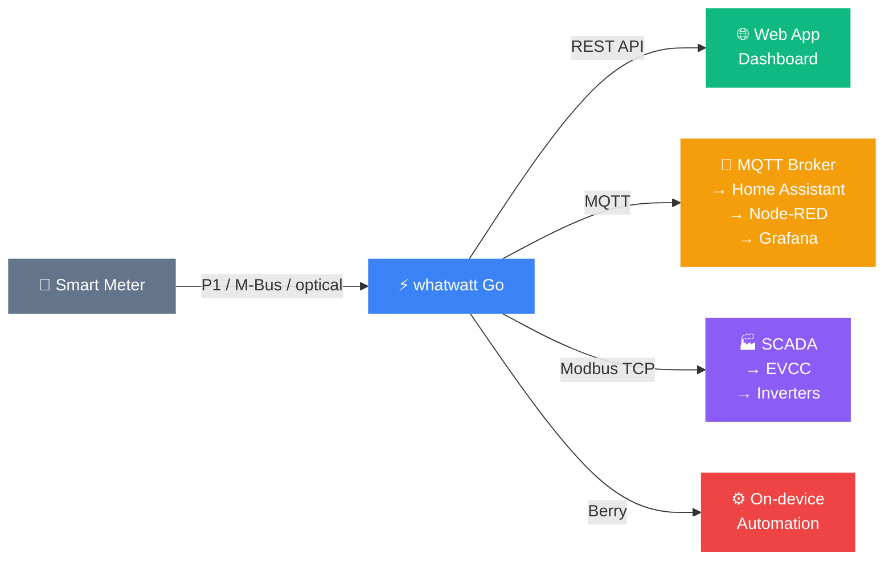
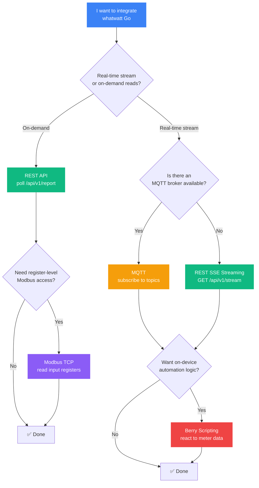

# whatwatt Go

**Your smart meter speaks. Listen locally.**

whatwatt Go is a compact device that connects directly to your smart meter's local interface and exposes real-time energy data through protocols you already use — REST, MQTT, and Modbus TCP. Your data stays on your local network by default, with optional cloud connectivity and license-based feature upgrades when you need them.

## Why whatwatt Go?

| | Without whatwatt Go | With whatwatt Go |
|---|---|---|
| **Data access** | Vendor portal, utility API, or manual meter reading | Local REST, MQTT, and Modbus TCP — instantly |
| **Real-time** | Delayed or batch data from cloud | Sub-second updates via SSE streaming and MQTT |
| **Privacy** | Data sent to third-party servers | Data stays on your network, under your control |
| **Integration** | Vendor-locked ecosystems | Any system that speaks HTTP, MQTT, or Modbus |
| **Automation** | Depends on cloud availability | Local Berry scripting engine runs on-device |

## How it works



whatwatt Go reads measurement data from the smart meter through its native local interface (P1, M-Bus, TTL, MEP, or optical), processes it, and re-exposes it through standard protocols on your local network. The device acts as a protocol bridge and data aggregator — your smart meter only speaks one protocol, but whatwatt Go gives you four ways to consume the data.

## Quick Start

Pick the protocol that fits your system. All examples assume the device is reachable at `192.168.1.100` — replace with your device's IP (discoverable via mDNS as `whatwatt-go.local`).

=== "REST API"

    Simplest way to get started — one HTTP request returns full meter data as JSON.

    ```bash
    # Check device availability and license type
    curl http://192.168.1.100/api/v1/system

    # Get the latest meter report (requires Plus or higher license)
    curl http://192.168.1.100/api/v1/report
    ```

    If `.device.license.type` is `PLUS` or higher, you can poll meter data, stream live updates via SSE, and configure the device — all through HTTP.

    **[→ REST API Guide](00-intro/first-request.md)** · **[→ Streaming](20-rest/streaming.md)**

=== "MQTT"

    Push-based real-time data — the device publishes to your broker, you subscribe.

    ```bash
    # Subscribe on YOUR MQTT BROKER to the topic you configured
    # in Device Settings → MQTT (publish.topic)
    mosquitto_sub -h 127.0.0.1 -t "lab/energy/#" -v
    ```

    Requires an active Plus or higher license for the built-in MQTT publisher.

    **[→ MQTT Guide](30-mqtt/index.md)**

=== "Modbus TCP"

    Register-level access for SCADA, EV chargers, and industrial systems.

    ```bash
    # Read the first 10 float registers (default Siemens PAC2200 layout)
    mbpoll -B -t 3:float -c10 -0 -r1 192.168.1.100
    ```

    The device ships with a default register map and supports custom layouts with configurable data types, scaling, and word order. Ready-to-load templates are available for Siemens, Carlo Gavazzi, Huawei, Fronius, Herholdt, SunSpec, and Janitza.

    **[→ Modbus TCP Guide](35-modbus/index.md)** · **[→ Templates](35-modbus/examples.md)**

=== "Berry Scripting"

    On-device automation — write scripts that react to meter data in real time.

    ```berry
    # Example: publish a warning when power exceeds 5 kW
    import meter

    func on_report(report)
        if report.instantaneous_power.active.positive.total > 5000
            log("High power consumption detected!")
        end
    end
    ```

    Requires an active Plus or higher license at runtime.

    **[→ Berry Scripting Guide](55-berry/index.md)**

## Choose Your Path

Not sure where to start? This decision tree helps you pick the right integration method:



## Documentation Map

### Getting Started

| Page | What you'll learn |
|------|-------------------|
| [Overview](00-intro/overview.md) | Device capabilities, supported protocols, and firmware compatibility |
| [REST vs MQTT](00-intro/rest-vs-mqtt.md) | Side-by-side comparison to help you choose the right protocol |
| [First Request](00-intro/first-request.md) | Your first REST API call — step by step |
| [Power & Wi-Fi](10-general/power-and-wifi.md) | Hardware setup and network requirements |
| [Device Discovery](10-general/discovery.md) | Find the device on your network via mDNS |
| [System Info](10-general/system-info.md) | Check device status, firmware, and license |

### Integration Methods

| Page | Protocol | Best for |
|------|----------|----------|
| [REST Polling](20-rest/polling.md) | HTTP | Web apps, dashboards, simple integrations |
| [REST Streaming](20-rest/streaming.md) | SSE | Live data without MQTT broker |
| [Modbus TCP](35-modbus/index.md) | Modbus | SCADA, EV chargers, inverters, industrial |
| [MQTT](30-mqtt/index.md) | MQTT 3.1.1 | Home Assistant, Node-RED, IoT platforms |
| [Secure MQTT](40-secure-mqtt/index.md) | MQTT/TLS | Production deployments with encryption |

### Configuration & Automation

| Page | What you'll learn |
|------|-------------------|
| [Device Settings](50-settings/rest-conventions.md) | Complete configuration reference via REST API |
| [Wi-Fi Setup](50-settings/wifi-setup.md) | Network configuration and troubleshooting |
| [Berry Scripting](55-berry/index.md) | On-device automation with Berry language |
| [Actions](50-settings/actions/index.md) | Automated HTTP/Modbus requests triggered by meter data |
| [SD Card Logging](50-settings/sdcard/index.md) | CSV data logging to SD card |

### Reference

| Page | What you'll find |
|------|------------------|
| [HTTP Basics](90-appendix/http-basics.md) | HTTP methods, status codes, and content types |
| [curl Examples](90-appendix/curl-options.md) | Command-line usage patterns |
| [OBIS Codes](90-appendix/appendix-d.md) | Energy measurement identifiers explained |
| [Report Objects](20-rest/report-objects.md) | Full JSON response structure with field descriptions |
| [License Requirements](20-rest/license-requirements.md) | Which features require which license tier |

### System Integrations

| Page | System |
|------|--------|
| [Loxone](60-integrations/loxone.md) | Loxone home automation integration |

## Supported Smart Meters

whatwatt Go works with smart meters from all major manufacturers:

| Manufacturer | Protocol | Regions |
|---|---|---|
| Ensor | P1 (Dutch DSMR) | NL, BE |
| Iskraemeco | P1 / optical | EU |
| Kamstrup | optical (KMP) | EU, Nordics |
| Landis+Gyr | P1 / optical | EU, CH |
| Sagemcom | P1 (French/Italian) | FR, IT |
| Semax | optical | EU |
| NES | P1 | NL |
| Meter+Control | optical | EU |

## License Tiers

| Feature | Free | Plus | Pro |
|---|:---:|:---:|:---:|
| REST API — system info & configuration | :material-check: | :material-check: | :material-check: |
| REST API — meter report polling | :material-close: | :material-check: | :material-check: |
| SSE streaming | :material-close: | :material-check: | :material-check: |
| MQTT publisher | :material-close: | :material-check: | :material-check: |
| Modbus TCP slave | :material-close: | :material-check: | :material-check: |
| Berry scripting | :material-close: | :material-check: | :material-check: |
| Actions (HTTP/Modbus automation) | :material-close: | :material-check: | :material-check: |
| SD card CSV logging | :material-close: | :material-check: | :material-check: |

Check your license with `curl http://<device-ip>/api/v1/system` — look for `.device.license.type`.

## Privacy by Design

> The Energy Transition will only succeed if we can optimize our own energy consumption. This is only possible if we know our consumption in real time and can react accordingly.

**Who owns your energy consumption data?** You do. The consumption data collected from your household belongs to you. You decide with whom you share it. whatwatt Go keeps your data on your local network by default — all integration protocols (REST, MQTT, Modbus, Berry) work without any cloud connection. Optional cloud services and license-based features are available when you choose to enable them.

---

<div style="text-align: center; margin: 2rem 0;">
  <a href="00-intro/overview" class="md-button md-button--primary">
    Get Started
  </a>
  <a href="https://whatwatt.ch" class="md-button" target="_blank">
    Learn More
  </a>
</div>

!!! info "Need Help?"
    - 📧 **Support**: Visit [whatwatt.ch/en/contact](https://whatwatt.ch/en/contact)
    - 📖 **FAQ**: Check [whatwatt.ch/en/faq-and-support](https://whatwatt.ch/en/faq-and-support)
    - 🛒 **Purchase**: Available at [whatwatt.ch/en/shop](https://whatwatt.ch/en/shop)
