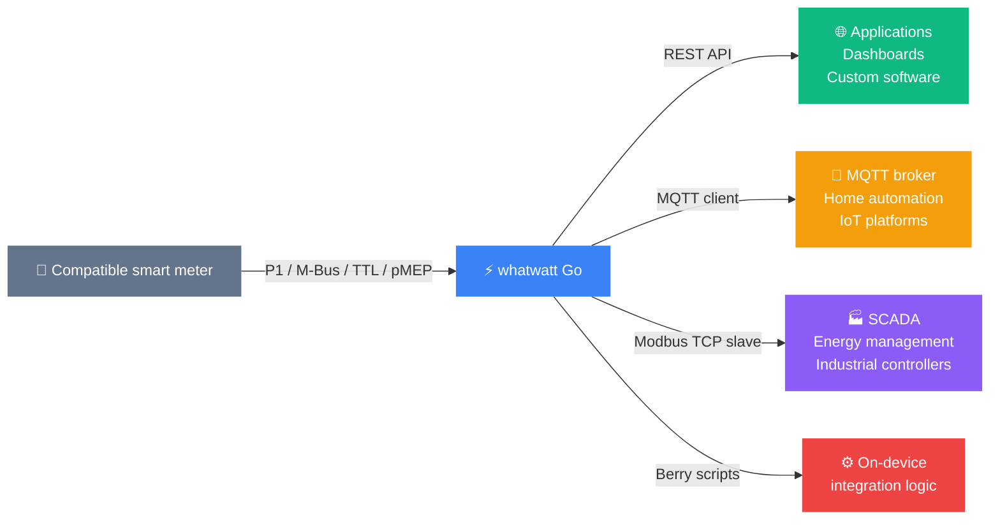
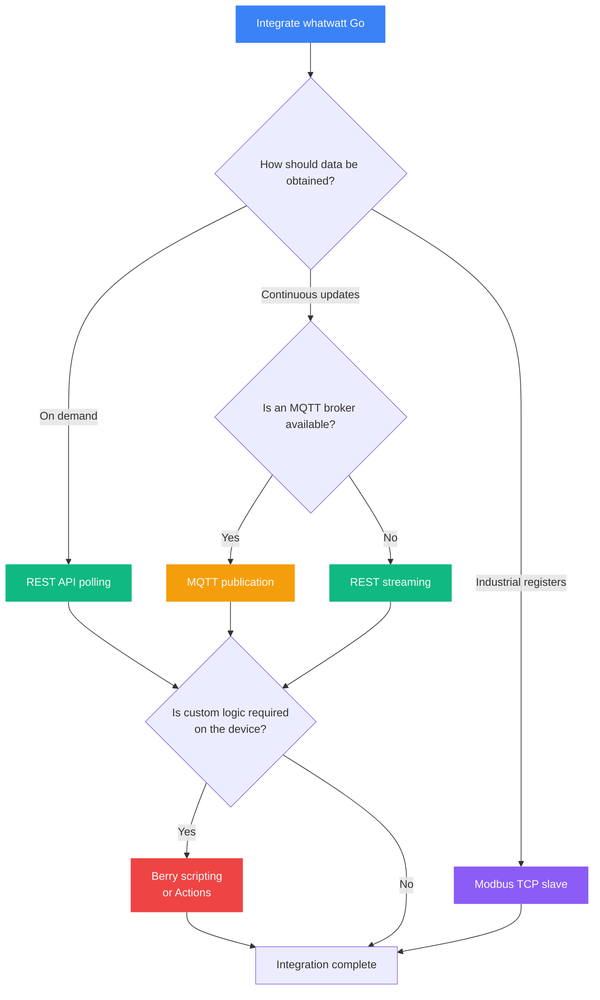

# whatwatt Go

**Read smart-meter data locally and integrate it with your own systems.**

whatwatt Go is a compact smart-meter interface device. It reads measurement data from a compatible electricity meter and makes the processed data available through local integration interfaces such as REST, MQTT and Modbus TCP.

Firmware 2.0.0 also introduces the Berry scripting environment for running custom integration logic directly on the device.

## Why use whatwatt Go?

|                       | Without a local meter interface                                    | With whatwatt Go                                                              |
| --------------------- | ------------------------------------------------------------------ | ----------------------------------------------------------------------------- |
| **Data access**       | Often limited to the meter display, utility portal or provider API | Local access through supported device interfaces                              |
| **Update interval**   | May be delayed or aggregated by an external service                | Determined primarily by the meter, protocol and configured reporting interval |
| **Local integration** | May require a vendor-specific ecosystem                            | REST, MQTT and Modbus TCP interfaces                                          |
| **Data processing**   | Usually performed by an external service                           | Measurements are parsed and normalised by the device                          |
| **Automation**        | Usually implemented in another controller or cloud service         | Actions and, in firmware 2.0.0, Berry scripts can run on the device           |

## How it works



whatwatt Go connects to a supported customer interface of the smart meter. Depending on the meter and installation, this can be:

- P1,
- M-Bus,
- UART/TTL, including supported Kamstrup HAN configurations,
- pMEP.

The device identifies and parses supported meter protocols, converts the received values into a common internal representation and exposes the available measurements through configured integration services.

The exact set of values and their update interval depend on the connected meter, its configuration and the protocol used.

## Quick Start

The examples below assume that the device is available at `192.168.1.100`.

A device can also be discovered through mDNS. Its hostname follows this pattern:

```text
whatwatt-XXXXXX.local
```

`XXXXXX` represents the last six hexadecimal characters of the device identifier.

When WebUI password protection is enabled, API requests require HTTP authentication. Using `--anyauth` allows `curl` to negotiate the authentication method supported by the installed firmware.

=== "REST API"

    Use the REST API for on-demand measurements, status information and device configuration.

    ```bash
    # Read device, network and meter status
    curl http://192.168.1.100/api/v1/system

    # Read the latest available meter report
    curl http://192.168.1.100/api/v1/report
    ```

    With password protection enabled:

    ```bash
    curl --anyauth -u ":PASSWORD" \
      http://192.168.1.100/api/v1/system
    ```

    `/api/v1/system` can be used even when no valid meter report is currently available. The contents of `/api/v1/report` depend on the values supplied by the connected meter.

    **[→ First REST Request](00-intro/first-request.md)** ·
    **[→ REST Polling](20-rest/polling.md)** ·
    **[→ REST Streaming](20-rest/streaming.md)**

=== "MQTT"

    whatwatt Go operates as an MQTT client and publishes data to a broker configured by the user.

    ```bash
    # Run this command on a system that can access your MQTT broker.
    # Replace the broker address and topic with your own configuration.
    mosquitto_sub \
      -h 192.168.1.20 \
      -t "lab/energy/#" \
      -v
    ```

    MQTT requires:

    - an MQTT broker reachable from whatwatt Go,
    - a configured broker address and port,
    - a configured publication topic,
    - optional credentials or TLS certificates when required by the broker.

    The MQTT payload can be adapted using the device's payload-template configuration.

    **[→ MQTT Guide](30-mqtt/index.md)** ·
    **[→ Secure MQTT](40-secure-mqtt/index.md)**

=== "Modbus TCP"

    Modbus TCP provides read-only register access for compatible industrial and energy-management systems.

    Enable the Modbus TCP slave service before attempting to read registers. The default TCP port is `502`, unless another port has been configured.

    ```bash
    # Example: read ten 32-bit floating-point values from input registers.
    # The correct start address and count depend on the active register map.
    mbpoll -B -t 3:float -c 10 -0 -r 0 192.168.1.100
    ```

    The Modbus implementation:

    - operates as a Modbus TCP slave,
    - supports function code `04` — Read Input Registers,
    - uses read-only input registers,
    - supports a default register map,
    - supports custom register maps,
    - supports configurable numeric types and scalers,
    - uses big-endian byte and word order.

    The active register map should always be checked before configuring a Modbus client.

    **[→ Modbus TCP Guide](35-modbus/index.md)** ·
    **[→ Modbus Examples](35-modbus/examples.md)**

=== "Berry Scripting"

    Firmware 2.0.0 includes a Berry scripting engine for implementing integration logic directly on the device.

    Scripts can react to meter reports, execute periodic functions, make HTTP or HTTPS requests, perform Modbus TCP transactions and call selected local APIs.

    ```berry
    import ww

    def on_report(report)
        if report and report.energy
            if report.energy.active and report.energy.active.positive
                var total_energy = report.energy.active.positive.total
                print("Imported active energy:", total_energy)
            end
        end
    end

    ww.onreport("on_report")
    ```

    The structure of a report passed to a script depends on the measurements available from the connected meter.

    An external USB-C power supply is recommended for continuous script execution, particularly when several communication services are enabled.

    **[→ Berry Scripting Guide](55-berry/index.md)**

## Choose an Integration Method



### REST API

Choose REST when an application needs:

- the latest available report on demand,
- device status or diagnostics,
- configuration access,
- a straightforward HTTP/JSON integration.

### MQTT

Choose MQTT when:

- an MQTT broker is already available,
- measurements should be published automatically,
- several consumers need to receive the same data,
- event-driven processing is preferred.

### Modbus TCP

Choose Modbus TCP when integrating with:

- SCADA systems,
- energy-management controllers,
- charging or photovoltaic equipment that can read Modbus TCP input registers,
- industrial software based on register maps.

Compatibility with a particular third-party product depends on its ability to use the configured function code, register addresses, data types, scaling and byte order.

### Berry and Actions

Choose on-device automation when logic should execute directly on whatwatt Go.

Berry is intended for programmable integrations. Actions provide configured HTTP or Modbus operations without requiring a complete custom firmware build.

## Documentation Map

### Getting Started

| Page                                          | Description                                           |
| --------------------------------------------- | ----------------------------------------------------- |
| [Overview](00-intro/overview.md)              | Device capabilities and available integration methods |
| [REST vs MQTT](00-intro/rest-vs-mqtt.md)      | Comparison of REST and MQTT integration models        |
| [First Request](00-intro/first-request.md)    | Initial REST API connectivity test                    |
| [Power & Wi-Fi](10-general/power-and-wifi.md) | Power-budget and network considerations               |
| [Device Discovery](10-general/discovery.md)   | mDNS and DNS-SD discovery                             |
| [System Info](10-general/system-info.md)      | Device, network, meter and service status             |

### Integration Methods

| Page                                   | Protocol      | Typical use                                |
| -------------------------------------- | ------------- | ------------------------------------------ |
| [REST Polling](20-rest/polling.md)     | HTTP/JSON     | On-demand reads and dashboards             |
| [REST Streaming](20-rest/streaming.md) | SSE           | Continuous HTTP-based updates              |
| [MQTT](30-mqtt/index.md)               | MQTT          | Broker-based telemetry                     |
| [Secure MQTT](40-secure-mqtt/index.md) | MQTT over TLS | Encrypted broker communication             |
| [Modbus TCP](35-modbus/index.md)       | Modbus TCP    | Industrial and register-based integrations |

### Configuration and Automation

| Page                                                | Description                                  |
| --------------------------------------------------- | -------------------------------------------- |
| [REST Conventions](50-settings/rest-conventions.md) | Common rules used by configuration endpoints |
| [Wi-Fi Setup](50-settings/wifi-setup.md)            | Wi-Fi client configuration                   |
| [Berry Scripting](55-berry/index.md)                | Programmable on-device integration logic     |
| [Actions](50-settings/actions/index.md)             | Configured HTTP and Modbus operations        |
| [SD Card Logging](50-settings/sdcard/index.md)      | Local CSV report storage                     |

### Reference

| Page                                                          | Description                                      |
| ------------------------------------------------------------- | ------------------------------------------------ |
| [HTTP Basics](90-appendix/http-basics.md)                     | HTTP methods, response codes and content types   |
| [curl Examples](90-appendix/curl-options.md)                  | Command-line request examples                    |
| [OBIS Codes](90-appendix/appendix-d.md)                       | Common measurement identifiers                   |
| [Report Objects](20-rest/report-objects.md)                   | JSON report structure and field descriptions     |
| [Availability and Licensing](20-rest/license-requirements.md) | Firmware, edition and service availability notes |

### System Integrations

| Page                                | System                      |
| ----------------------------------- | --------------------------- |
| [Loxone](60-integrations/loxone.md) | Loxone integration guidance |

## Supported Smart Meters

whatwatt Go supports several customer-interface and protocol combinations. Compatibility should be determined from the meter model, installed communication module, enabled customer port and meter configuration.

The following examples are included in the published compatibility documentation:

| Manufacturer   | Example models or series         | Interface or setup                            |
| -------------- | -------------------------------- | --------------------------------------------- |
| Ensor          | eRS301, eRS801                   | P1, RJ12                                      |
| Iskraemeco     | AM550 with supported CII module  | P1, RJ12                                      |
| Kamstrup       | Omnipower, Omnia                 | P1 or TTL/HAN, depending on meter and adapter |
| Landis+Gyr     | E360                             | P1, RJ12                                      |
| Landis+Gyr     | E450 S4/S5, E570                 | M-Bus, RJ12                                   |
| Meter+Control  | Flexy                            | P1, RJ12                                      |
| NES            | 83335-3, generation 5            | P1, RJ12                                      |
| NES            | 83332-3 and 83334-3              | pMEP, installation-dependent                  |
| Sagemcom       | S211, T211                       | P1, RJ12                                      |
| Sagemcom       | S210, T210-D                     | M-Bus, RJ12                                   |
| Semax / Elster | AS3000 with supported CII module | P1, RJ12                                      |
| Kaifa          | MA309M                           | M-Bus, RJ12                                   |

Some installations require:

- activation of the customer interface by the utility,
- meter encryption or authentication keys,
- an adapter or communication module,
- external USB-C power,
- specific firmware support.

A standard interface alone does not guarantee that every meter variant or configuration is supported. Consult the current compatibility list or whatwatt support when a meter is not explicitly listed.

## Firmware and Service Availability

Available functions depend on:

- the installed firmware version,
- device configuration,
- hardware revision,
- enabled services,
- applicable commercial edition or service terms.

For example:

- Modbus TCP slave support was introduced in firmware 1.2.20,
- Berry scripting is a firmware 2.0.0 feature,
- the device reports its firmware version through `/api/v1/system`,
- newer firmware can expose license information such as `.device.license.type` and `.device.license.activation_date`.

Do not infer feature availability solely from the presence of a license field. Verify the installed firmware, service configuration and current product terms.

```bash
curl http://192.168.1.100/api/v1/system
```

With authentication enabled:

```bash
curl --anyauth -u ":PASSWORD" \
  http://192.168.1.100/api/v1/system
```

## Local Operation and Data Control

whatwatt Go supports local data access through REST, MQTT, Modbus TCP, SD-card logging and on-device automation.

REST and Modbus clients can communicate with the device directly over the local network. For MQTT, measurement data is sent to the broker configured by the user; that broker may be local or remote.

The device can also use optional cloud and third-party integrations when they are enabled. Therefore, whether measurement data remains entirely within the local network depends on the selected configuration.

To maintain local-only operation:

- use a broker hosted inside the local network,
- disable unnecessary cloud integrations,
- restrict outbound network access where appropriate,
- protect the WebUI and API,
- use TLS where supported and required,
- review all enabled services before deployment.

The user determines which configured systems receive the available meter data.

---

<div style="text-align: center; margin: 2rem 0;">
  <a href="00-intro/overview" class="md-button md-button--primary">
    Get Started
  </a>
  <a href="https://whatwatt.ch" class="md-button" target="_blank">
    Learn More
  </a>
</div>

!!! info "Need Help?"
    - 📧 **Support:** [whatwatt.ch/en/contact](https://whatwatt.ch/en/contact)
    - 📖 **FAQ:** [whatwatt.ch/en/faq-and-support](https://whatwatt.ch/en/faq-and-support)
    - 🛒 **Shop:** [whatwatt.ch/en/shop](https://whatwatt.ch/en/shop)
